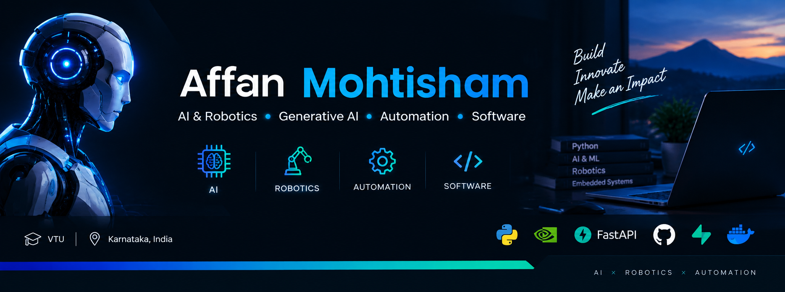

# Hi, I'm Affan Mohtisham 👋 

### AI & Robotics Student | Developer | Builder

I'm an AI and Robotics student at Visvesvaraya Technological University (VTU), interested in building practical AI-powered systems, automation tools, and robotics projects.

I enjoy turning ideas into working software and experimenting with AI, computer vision, automation, and intelligent systems.

---

## 🚀 What I'm Building

### 🎬 MascotAI
An AI-powered video generation and production platform.

**Current pipeline:**

`Prompt → AI Director → Storyboard → AI Video Scenes → Voice → Music → SFX → Captions → Final Video`

The project combines local AI models with a production pipeline designed to eventually become a scalable SaaS platform.

🔗 [MascotAI Repository](https://github.com/upbeatmagnit0213/MASCOTAI)

---

## 🤖 AI & Robotics

I'm currently working on projects involving:

- Artificial Intelligence
- Robotics
- Computer Vision
- Automation
- AI Video Generation
- Speech & Voice AI
- Embedded Systems
- IoT
- Hardware Testing

### Robotics Projects

- 🤖 Line Follower Robot
- 🔥 Robotic Fire-Water Sprinkler
- 🦾 Automated Robotic Arm
- 📡 Radar System — In Progress

---

## 🛠️ Technologies & Tools

### Programming

### AI / ML
- NVIDIA AI APIs
- LTX-Video
- Chatterbox TTS
- Faster-Whisper
- AI-assisted video generation
- Speech & language processing

### Development
- FastAPI
- Git & GitHub
- REST APIs
- FFmpeg
- Supabase
- Windows / Python environments

### Hardware
- Embedded Systems
- Robotics
- Sensors
- IoT
- Hardware testing

---

## 📚 Currently Learning

- Advanced AI & Machine Learning
- AI Video Generation
- Generative AI
- Robotics
- Computer Vision
- Embedded Systems & IoT
- AI-powered applications
- Production-ready SaaS development

---

## 🏆 Activities & Experience

- 🇮🇳 Inter-District Youth Exchange Program
- ⚽ State-level sports participation
- 🏃 Inter-District Athletics Programs
- 🏕️ National-level selection / training programs
- 🤝 Youth and community volunteering

---

## 🎯 My Goal

To build useful AI and robotics products that solve real-world problems and make advanced technology accessible to more people.

I'm particularly interested in the intersection of:

**AI × Robotics × Automation × Software**

---

## 🤝 Connect With Me

- 💼 [LinkedIn](https://www.linkedin.com/in/affan-mohtisham/)
- 🐙 [GitHub](https://github.com/upbeatmagnit0213)

I'm open to learning, collaborating on interesting projects, and connecting with other developers and AI/Robotics enthusiasts.

---

### ⚡ Fun Fact

I like building things from scratch and testing whether an idea can actually work in the real world.

⭐ If you find any of my projects interesting, feel free to explore the repositories!
